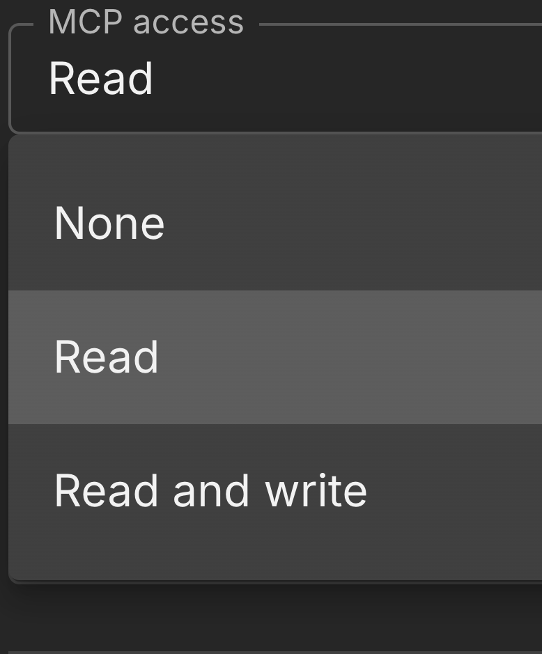

# AI assistant (MCP)

Ask Claude or ChatGPT about your inquiries, quotes, customers, inventory, shop issues, and production work. The assistant uses your AirShop login, so it only sees and changes what that person is allowed to do in AirShop.

!!! note "Beta"
    AI assistant (MCP) is in beta. An org admin with an active subscription requests access on **[Settings → Integrations → AI assistant (MCP)](https://airshop.work/settings/integrations/mcp){ target="_blank" rel="noopener noreferrer" }**. AirShop enables your organization when you are approved. See [Subscription](setup/subscription.md).

## What you can do

**Read** (after your organization is approved and your user has MCP access):

- Find inquiries, quotes, and customers
- Look up inventory items, low stock, procurement sources, and notes
- List open shop issues and production work assigned to you
- Check how much MCP usage you have left

**Write** needs **Read and write** on that person, or on their role. They can only change data their role already allows.

With write access, the assistant can:

- Add notes and update status on issues and inquiries
- Draft a follow-up email
- Set inventory counts, low quantity, reorder quantity, and item status
- Update procurement source details and notes
- Create an inventory item

Changes made through the assistant show in the activity log with an **MCP** label.

## Request access

1. Confirm your organization has an active AirShop subscription.
2. An org admin opens **[Settings → Integrations → AI assistant (MCP)](https://airshop.work/settings/integrations/mcp){ target="_blank" rel="noopener noreferrer" }** and chooses **REQUEST ACCESS**.
3. After AirShop approves your organization, an org admin chooses who can read and who can write. See [Choose who can read and who can write](#choose-who-can-read-and-who-can-write).
4. That person opens **[Settings → Integrations → AI assistant (MCP)](https://airshop.work/settings/integrations/mcp){ target="_blank" rel="noopener noreferrer" }**.

If your organization is approved but you see no connector URL, your user does not have MCP access yet. Ask an org admin to grant **Read** or **Read and write**.

## Choose who can read and who can write

Nobody can use the assistant until an org admin grants access. Two places control it.

### One person

{ .screenshot }

1. Open **[Settings → Users](https://airshop.work/settings/users){ target="_blank" rel="noopener noreferrer" }**.
2. Edit the person.
3. Set **MCP access**:
    - **None:** no assistant access from this setting.
    - **Read:** look up data.
    - **Read and write:** look up data and make changes their role already allows.

This adds access for that person. It does not remove access their role already includes. To take role access away, change the role.

### Everyone in a role

1. Open **[Settings → Users](https://airshop.work/settings/users){ target="_blank" rel="noopener noreferrer" }** and choose **Manage Roles**.
2. Edit the role.
3. Under **AI assistant (MCP)**, turn on:
    - **Can use AirShop MCP (read)?**
    - **Can use AirShop MCP (write)?**

Everyone with that role gets the access you turn on. They still only see and change data that role already allows.

### What they can touch

Assistant access does not bypass the rest of their AirShop permissions. A person who cannot edit inventory in AirShop cannot change inventory through Claude or ChatGPT. The same applies to inquiries, quotes, customers, and sources.

## Connector URL

Use this URL in Claude and ChatGPT:

```
https://airshop.work/api/mcp
```

The URL is the same for every organization. Access comes from the AirShop account you sign in with. If the assistant asks for a transport, choose **Streamable HTTP**.

You can also copy the URL from **[Settings → Integrations → AI assistant (MCP)](https://airshop.work/settings/integrations/mcp){ target="_blank" rel="noopener noreferrer" }** after your organization is approved.

## Claude (desktop, web, mobile)

1. Open **Settings → Connectors** and choose **Add custom connector**.
2. Name it AirShop. Paste `https://airshop.work/api/mcp`. Pick **Streamable HTTP** if asked.
3. Sign in with the AirShop email that has MCP access.
4. Approve access on the AirShop consent screen.

## ChatGPT

1. Use a ChatGPT plan that supports custom MCP connectors. Turn on **developer mode** if ChatGPT requires it.
2. Add a connector. Name it AirShop and paste `https://airshop.work/api/mcp`.
3. Sign in with the AirShop email that has MCP access and approve access.

## Example requests

Read:

- "Find quotes for Acme Fabrication"
- "Which inventory items are low on stock?"
- "Look up the end mill by item code"
- "List open shop-floor issues"
- "What production work is assigned to me?"
- "How much MCP usage do I have left?"

Write (only when your organization and your user have write access):

- "Add a note to the cracked weld issue"
- "Mark that inquiry as accepted"
- "Draft a follow-up email to this customer"
- "Set this item count to 40, low qty to 6, and reorder qty to 24"
- "Mark that inventory item ORDER NOW"

## Usage

Calls reset daily. Units reset monthly. Bigger lookups use more units. Your limits and what you have left are on the **[AI assistant (MCP)](https://airshop.work/settings/integrations/mcp){ target="_blank" rel="noopener noreferrer" }** page. You can also ask the assistant how much MCP usage you have left.

## Troubleshooting

**Unauthorized**

Your organization is not in the beta yet, your subscription is not active, or your user does not have MCP access. Open this page in AirShop and choose **Request access**, then ask an org admin to set **MCP access** in **Settings → Users**.

**Limit reached**

Check **Usage** on the AI assistant page, or ask the assistant how much MCP usage you have left. Wait until the daily or monthly limit resets.

**Missing tools or data**

Your AirShop role may not include that data. Ask an org admin to check your role, and to set **MCP access** on your user or **AI assistant (MCP)** on your role. Changes need **Read and write**.

**Wrong account**

Disconnect the connector in Claude or ChatGPT, add it again, and sign in with the AirShop user who has MCP access.

## Related

- [Subscription](setup/subscription.md)
- [Integrations](integrations/index.md)
