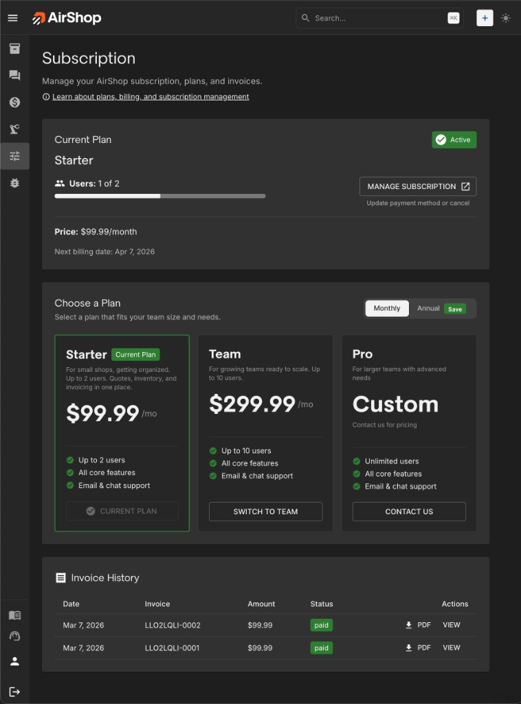
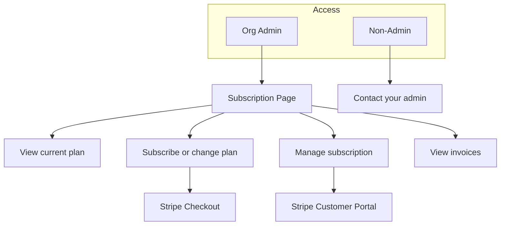

# Subscription

A paid subscription is required for all AirShop organizations. Organization administrators manage plans and payment at [airshop.work/subscription](https://airshop.work/subscription).

!!! note "Subscription vs. customer payments"
    This page is your **AirShop subscription** (paying for app access).

    **Customer quote payments** (deposits, milestones, and invoice links on your own Stripe account) are configured separately. See **[Quotes & invoicing with Stripe Connect](stripe-payments.md)**.

---

## Plans & Pricing

AirShop offers four self-serve subscription tiers. Current prices appear on the [Subscription page](https://airshop.work/subscription).

| Plan | Price | Billing | Users | Best for |
|------|-------|---------|-------|----------|
| **Solo** | $35/mo | Monthly only | 1 | Solo operators and side projects |
| **Starter** | $99/mo | Monthly or annual | Up to 2 | Freelancers and small shops |
| **Team** | $299/mo | Monthly or annual | Up to 10 | Growing businesses |
| **Pro** | Custom | Contact us | Unlimited | Larger teams with unique needs |

Starter and Team include a discount when you pay annually. Solo is monthly only.

### What's included

**Solo**

- 1 user
- 10 quotes per month
- 10 orders per month
- Core AirShop features within those limits

Solo does not include **Shopboard Sync** (live inquiry and quote updates on a shop floor display). Solo organizations enrolled in the Shopboard private beta may use Shopboard in **personal mode** only. See [Shopboard](shopboard.md).

**Starter, Team, and Pro**

- All core features (quotes, inventory, inquiries, customers, payments, and integrations)
- **Shopboard Sync** on Starter and above: connect a Raspberry Pi shop floor display for live AirShop activity (private beta; org enrollment required)
- Support level varies by plan (email and chat on Starter, priority on Team, dedicated on Pro)

Pro pricing is custom. Use **Contact Us** on the Subscription page or [book a demo](https://cal.com/airshop/demo).

Each team member must have their own user account. Sharing a single login across multiple people is not permitted. We monitor for misuse.

---

## How to Subscribe

1. Go to [Subscription](https://airshop.work/subscription) (or **Settings** → **Subscription**, or the Subscription link in the left nav).
2. Choose **monthly** or **annual** billing (Solo is monthly only).
3. Select a plan (Solo, Starter, Team, or Pro).
4. Click **Subscribe** to open Stripe Checkout.
5. Enter your payment details and complete the checkout.

After payment succeeds, your organization is active and you can continue using AirShop.

---

## Managing Your Subscription

{ .screenshot }

_Screenshot shows a Starter subscription example. The live Subscription page lists Solo, Starter, Team, and Pro; plan cards and features may differ from this capture._

Use **Manage subscription** on the [Subscription page](https://airshop.work/subscription) to open the Stripe Customer Portal. There you can:

- Update your payment method
- Change your plan (upgrade or downgrade)
- Switch between monthly and annual billing (Starter and Team only)
- Cancel your subscription
- View and download invoices

_The payment portal opens in a new tab._

### Upgrade & Downgrade

| | When | What happens |
|---|-----|--------------|
| ↑ **Upgrade** (tier or monthly→annual) | Immediate | Prorated charge for rest of billing period |
| ↓ **Downgrade** (tier or annual→monthly) | End of period | Keep current plan until renewal |
| **User limit** | Before downgrade | Remove users first if over new plan's slots |

---

## Invoice History

Past invoices for your AirShop subscription appear on the Subscription page. You can also view and download invoices from the Stripe Customer Portal (via **Manage subscription**).

---

## Trial

New organizations receive a 14-day free trial with full Team features. During the trial:

- A **trial banner** in the nav shows how many days remain.
- When the trial is about to end, you'll see alerts prompting you to subscribe.

When the trial ends, you must subscribe to continue using AirShop. Go to [Subscription](https://airshop.work/subscription) to choose a plan and complete checkout.

---

## Who Can Manage Subscription

Only **Organization Administrators** can access the Subscription page and manage plans and payment. If you're not an admin, you'll see a message to contact your organization admin.

Admins can manage subscription from **Settings** or the Subscription link in the left nav.

---

## Payment Issues

**Past due** — If a payment fails, you have a grace period to update your payment method. Alerts will prompt you.

**Blocked access** — If payment isn't updated or your subscription is canceled, access may be blocked. The Subscription page stays accessible so you can update payment or reactivate.

**Reactivating** — Go to [Subscription](https://airshop.work/subscription) and update your payment method (if past due) or subscribe again (if canceled).

---

## Subscription Flow

---

## Related

- [Shopboard](shopboard.md) — Shop floor displays, Shopboard Sync, and plan requirements
- [Quotes & invoicing with Stripe Connect](stripe-payments.md) — Collecting deposits or milestones from **your** customers (separate from your AirShop subscription here).
- [Setup FAQ](faq.md)
- [Glossary](../glossary.md) — Subscription, Organization Administrator
